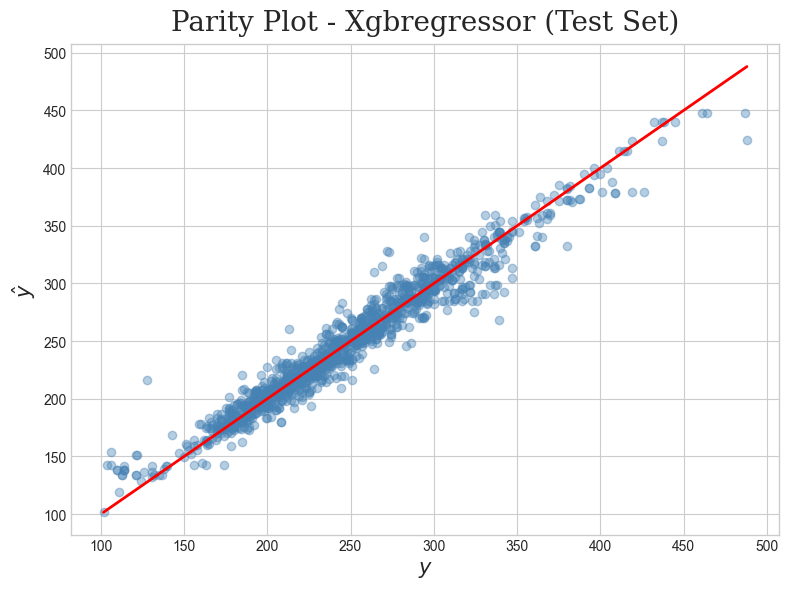
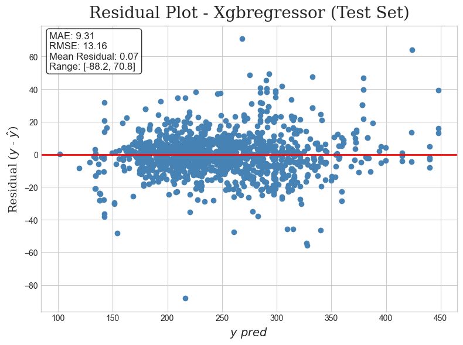
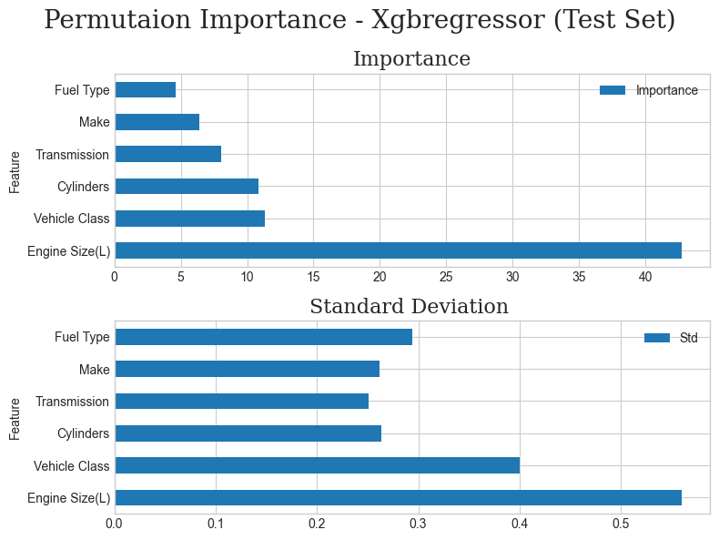

# CO2 Emission Prediction (Pre-Production Scenario)

Predicting a vehicle's CO2 emissions (g/km) from its **declared specifications alone** — before it is physically built and fuel-consumption tested — using tree-based regression models trained on the [CO2 Emission by Vehicles](#dataset) dataset.

### Highlights

- **Leakage-aware feature scope**: fuel-consumption features (correlation ≈0.9+ with the target) are deliberately excluded, because they are only measurable _after_ a physical prototype exists — using them would leak post-production information into a pre-production task. An earlier iteration that included them reached a near-perfect but meaningless R² ≈ 0.99; see [Problem Framing](#problem-framing).
- **Disciplined train/test separation**: the test set is touched exactly once, for the final model only. Every model comparison and selection decision (Sections 9–11 of the notebook) is based purely on training data and cross-validation — never on test metrics.
- **Every modeling decision is justified inline**, not just stated — including the ones that look counterintuitive at first (e.g. why the categorical feature with the _highest_ Mutual Information score was still dropped).

## Table of Contents

- [Problem Framing](#problem-framing)
- [Results](#results)
- [Repository Structure](#repository-structure)
- [Installation](#installation)
- [Usage](#usage)
- [Methodology Summary](#methodology-summary)
- [Limitations](#limitations)
- [Future Work](#future-work)
- [Dataset](#dataset)
- [License](#license)
- [Author](#author)

## Problem Framing

This project simulates a **pre-production** deployment scenario: predicting CO2 emissions using only the vehicle specifications that are known before physical prototyping and standardized fuel-consumption testing (`Make`, `Vehicle Class`, `Engine Size`, `Cylinders`, `Transmission`, `Fuel Type`).

Fuel-consumption features (City/Highway/Combined), while highly correlated with the target, are only measurable _after_ a physical test and are therefore excluded from the model — using them would leak post-production information into a pre-production prediction task. An earlier iteration of this project that included these features reached a near-perfect R² (~0.99); inspecting feature importance revealed this was driven by data leakage rather than genuine predictive signal, which motivated the current framing. See `notebook/CO2 Emission.ipynb`, Section 1.4, for the full discussion.

## Results

Final model: **XGBoost Regressor**, selected from four tuned candidates (Random Forest, XGBoost, Extra Trees, Decision Tree) based on cross-validated RMSE on the training set. The test set was touched exactly once, for this model only.

| Metric      | Train | Test  |
| ----------- | ----- | ----- |
| R²          | 0.97  | 0.95  |
| MAE (g/km)  | 7.49  | 9.31  |
| RMSE (g/km) | 10.67 | 13.16 |

The most influential feature by permutation importance is `Engine Size(L)`, followed by `Vehicle Class` and `Cylinders` — consistent with the physical relationship between engine displacement and fuel burned.

<p align="center">
  
  
  
</p>

## Repository Structure

```
├── data/                     # Raw dataset (see data/README.md for source/license)
├── notebook/                 # End-to-end exploratory notebook (EDA, modeling, diagnostics)
├── reports/                  # Rendered HTML export of the notebook
├── src/co2_predictor/        # Modular, OOP implementation used by scripts/
├── scripts/                  # Training entrypoint (scripts/run_training.py)
├── models/                   # Persisted fitted pipeline (generated, not committed)
├── figures/                  # Selected plots referenced in this README
├── tests/                    # Unit tests for src/co2_predictor
├── pyproject.toml            # Package metadata and dependencies
└── LICENSE
```

## Installation

```bash
git clone https://github.com/<your-username>/CO2-Emission.git
cd CO2-Emission
pip install -e .
```

## Usage

**Reproduce the full analysis:** open `notebook/CO2 Emission.ipynb`.

**Retrain the model from the command line:**

```bash
python scripts/run_training.py
```

**Predict on new vehicle specifications:**

```python
from co2_predictor.inference.predictor import CO2Predictor
import pandas as pd

predictor = CO2Predictor(model_path="models/xgb_pipeline.joblib")

new_vehicle = pd.DataFrame([{
    "Make": "TOYOTA",
    "Vehicle Class": "COMPACT",
    "Engine Size(L)": 2.0,
    "Cylinders": 4,
    "Transmission": "AS8",
    "Fuel Type": "Z",
}])

predictor.predict(new_vehicle)
```

## Methodology Summary

1. **Data cleaning** — duplicate removal (~15% of raw records were exact duplicates).
2. **EDA** — target distribution, VIF, ANOVA, Mutual Information; used to justify every feature-scope decision below, not just to describe the data.
3. **Feature scope** — dropped `Model` (high cardinality: 2,053 unique values for 6,282 records) and all fuel-consumption columns (pre-production framing, see above).
4. **Feature engineering** — a single derived feature (`Cylinders / Engine Size`) was tested against a rejected alternative (`Cylinders × Engine Size`) via cross-validation before being added to the final pipeline.
5. **Model comparison** — four tree-based models, each tuned with `RandomizedSearchCV` over a shared `RepeatedKFold` strategy (5 folds × 3 repeats); linear baselines were evaluated but underperformed substantially.
6. **Model selection & evaluation** — selection based entirely on train/CV metrics; the test set is used exactly once, at the end, for the selected model only.

Full reasoning for every decision above — including the ones that trade off signal for robustness — is documented inline in `notebook/CO2 Emission.ipynb`.

## Limitations

- **Feature scope**: `Model` was excluded despite having the highest Mutual Information among categorical features, due to its high cardinality relative to dataset size.
- **Underrepresented manufacturers**: some manufacturers (e.g., Bugatti, SRT) have as few as 2 records; performance for these cannot be reliably estimated from the current test set.
- **Domain coverage**: the dataset includes only vehicles with a combustion-based fuel type (gasoline, diesel, ethanol, natural gas), including conventional (non-plug-in) hybrids such as gasoline-electric hybrids, which are tested and reported identically to non-hybrid vehicles. It does not include battery-electric (BEV) or plug-in hybrid (PHEV) vehicles, whose emissions profile cannot be captured by the same fuel-consumption-based measurement framework. Results should not be extrapolated to these powertrain types.
- **Single train/test split**: reported test metrics reflect one specific random split rather than a distribution across multiple splits.

## Future Work

- Explore target/frequency encoding for `Model` to recover predictive signal without the dimensionality cost of one-hot encoding.
- Extend to electric and hybrid (BEV/PHEV) vehicles, which require a different measurement framework than the one used here, to assess generalization beyond the current dataset's scope.
- Evaluate across multiple random splits/seeds to obtain a confidence interval on test performance.
- Expand `tests/` coverage and add CI (GitHub Actions) to run tests on every push.
- Add a CLI argument to `scripts/run_training.py` for overriding the dataset path (currently fixed via `config.py`).

## Dataset

[CO2 Emission by Vehicles](https://www.kaggle.com/datasets/debajyotipodder/co2-emission-by-vehicles) (Kaggle), originally compiled from [Government of Canada Open Data](https://open.canada.ca/data/en/dataset/98f1a129-f628-4ce4-b24d-6f16bf24dd64). See [`data/README.md`](data/README.md) for the exact source link, retrieval date, license terms, and a reference table decoding the dataset's column abbreviations (fuel type, transmission, and model codes).

## License

This repository's code is licensed under the MIT License — see [LICENSE](LICENSE). The dataset itself is governed by its own, separate license — see [`data/README.md`](data/README.md).

## Author

**Ali Khajouei**
[GitHub](https://github.com/alikhajouei2006/) · [LinkedIn](https://www.linkedin.com/in/ali-khajouei)
